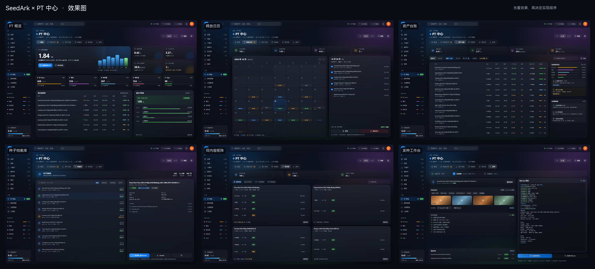
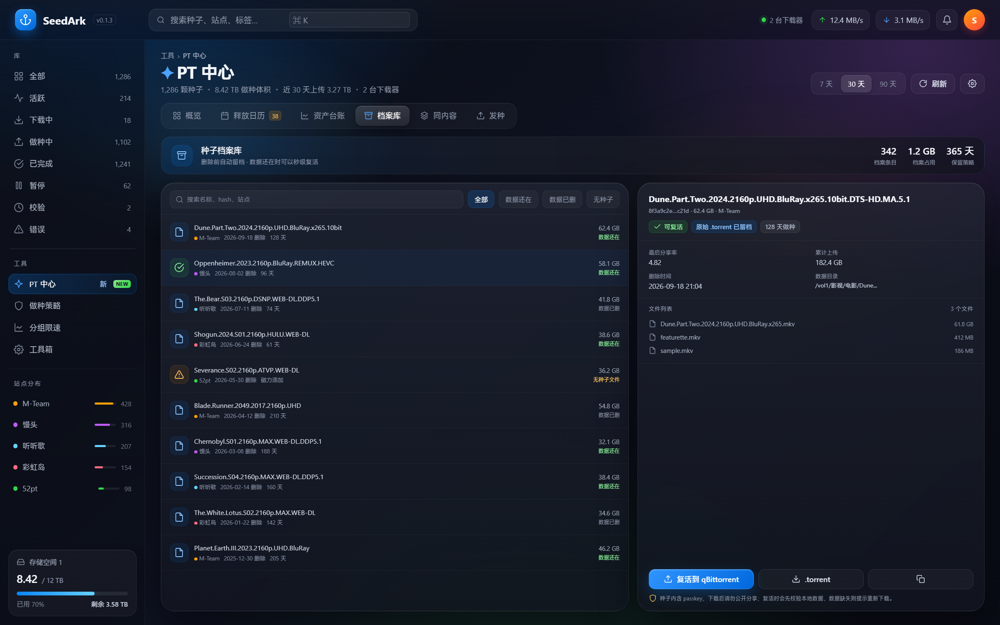
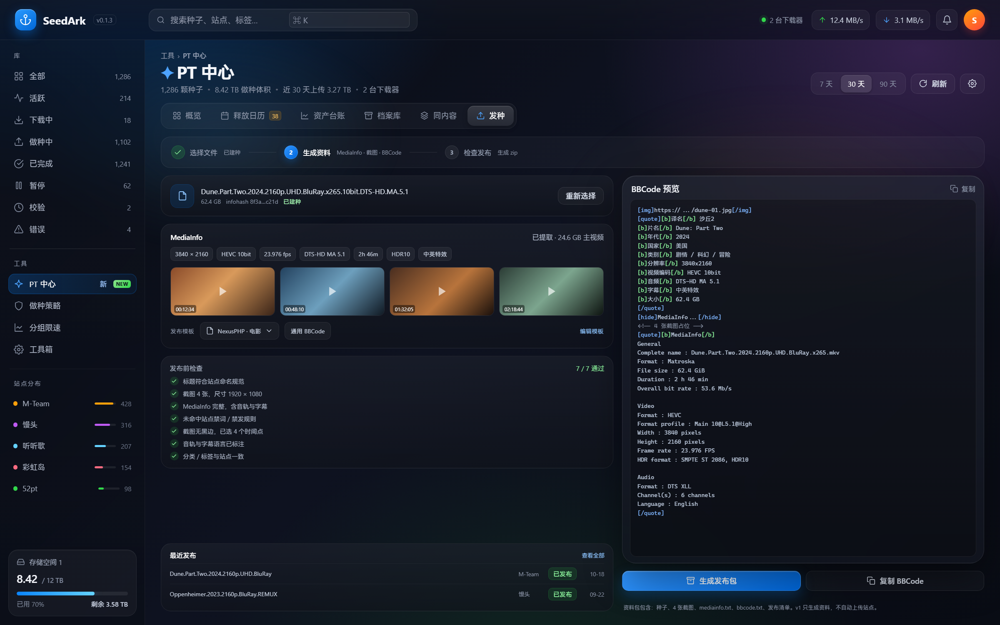

# SeedArk × PT 功能提案

> 目标：在**不与 MoviePilot 抢活**的前提下，找出 SeedArk 作为「下载器侧面板」真正该做的 PT 功能。
>
> 调研基线：MoviePilot 主程序 + 官方插件市场 + 常见第三方插件（截至 2026-10）。
> 相关链接：[MoviePilot](https://github.com/jxxghp/MoviePilot)、[官方插件市场](https://github.com/jxxghp/MoviePilot-Plugins)、[MoviePilot Wiki](https://wiki.movie-pilot.org/)。

---

## 0. 结论先行

### 推荐做的 5 个方向

| 优先级 | 方向 | 一句话 | 与 MoviePilot 的重叠 |
|:--|:--|:--|:--|
| P0 | **保种资产台账** | 每颗种子到底在不在上传、值不值得留、哪个站最费盘 | 低（MP 是账号维度，不是种子维度） |
| P0 | **保种释放日历** | 哪天能安全删、当天能腾多少盘、会不会踩 H&R | 低（MP 只管它自己下载的 H&R 种子） |
| P1 | **种子档案库 + 复活** | 删掉的种子留档，误删/换盘后一键加回 | 无（MP 的自动备份备的是配置） |
| P1 | **发种工作台** | 建种后自动出 MediaInfo、截图、BBCode 和发布包 | 无（MP 只消费资源，不生产资源） |
| P2 | **跨站同内容矩阵** | 同一部片在几个站/几台下载器上各种了一份，谁在传 | 低（MP 的辅种是自动化，不是资产视图） |

### 明确不做

站点签到、刷流、IYUU/自动辅种、站点数据大屏、RSS 订阅、媒体整理/刮削、H&R 自动打标/收容/删种、通用自动删种。
这些要么是 MoviePilot 主程序的核心，要么官方/第三方插件已经做得很完整，SeedArk 再做一套只会增加维护面，不会增加用户价值。

### 建议的 MVP

**站点规则配置 + 保种资产台账 + 释放日历**，约 10~12 人日。
先验证一件事：用户是否愿意每天打开 SeedArk 看「我的种子值多少、什么时候能删」。
这个验证通过后，再做档案库和发种工作台。

> 效果图（静态原型）见 [4.5 节](#45-效果图静态原型)：[总览拼图](mockups/00-contact-sheet.png) · [可交互 HTML](mockups/pt-center.html)

---

## 1. 先划边界：MoviePilot 已经覆盖了什么

MoviePilot 的 PT 能力基本都围绕一条流水线：**找资源 → 订阅/下载 → 整理入库 → 清理**。
插件市场的 PT 相关能力可以归成下面几类：

| 能力 | MoviePilot 现状 | 代表插件 | SeedArk 策略 |
|:--|:--|:--|:--|
| 站点搜索 / 订阅 / RSS | 主程序核心 | 主程序、`RssSubscribe` | 不做 |
| 站点刷流 | 官方插件，功能很完整 | `BrushFlow` | 不做 |
| 站点签到 / 保号 | 官方插件 | `AutoSignIn` | 不做 |
| 自动辅种 | 官方 + 第三方 | `IYUUAutoSeed`、`CrossSeed` | 不做自动辅种；只做「同内容可见」 |
| 站点数据统计 | 官方 + 第三方 | `SiteStatistic`、`PTDataStatistics` | 不做账号大屏；只做本地账本 |
| H&R 管理 | 第三方已很成熟 | `HitAndRunQ`（H&R 助手）、`HRBlocker` | 不做打标/收容/自动删；只把 H&R 作为规则字段 |
| 无效做种 / 红种 | 第三方 | `SeedSourceGuard`（做种守卫）、`CleanInvalidSeed` | 不重复造检测引擎；台账里展示状态即可 |
| 自动删种 / 转移做种 | 官方 | `TorrentRemover`、`TorrentTransfer` | 已有做种策略；不做通用删种 |
| 播放限速 / 上传限速 | 官方 + 第三方 | `SpeedLimiter`、`QbUploadLimiter` | 已有分组限速；不做第二套 |
| 媒体整理 / 刮削 / 通知 | 主程序核心 | 主程序、`LibraryScraper` 等 | 不做 |
| **发种 / 发布** | **未发现**面向 PT 站的发种能力 | — | **做** |
| **种子档案 / 复活** | **未发现** | — | **做** |
| **本地做种资产账本** | **未发现**（只有账号维度） | — | **做** |
| **释放日历 / 保种预算** | **未发现**（H&R 到期只覆盖 MP 管理的种子） | — | **做** |
| **跨站同内容资产视图** | **未发现**（辅种是自动化，不是视图） | — | **做** |

一个容易忽略的点：MoviePilot 的 H&R 助手、做种守卫、刷流等插件，大多围绕「MP 的下载记录」或「异常处置」——
H&R 助手管它自己下载的种子，做种守卫重点是无效做种/红种，刷流是 MP 的刷流任务。
它们不回答「全量种子的资产、收益、释放计划」；用户手动加的种子、辅种来的种子、非影视资源（音乐/游戏/电子书/学习资料）的种子，往往不在这些视图里。
SeedArk 的天然优势就是：**它看得到下载器里的全部种子**。

---

## 2. SeedArk 的差异化资产

这些是 MoviePilot 结构性不擅长的，也是新功能应该依赖的：

1. **下载器原生**：不依赖 TMDB、媒体库、媒体服务器，任意类型的 PT 种子都成立。
2. **全量种子**：手动添加、辅种、刷流、MP 下载的，在 SeedArk 里是同一张表。
3. **多下载器聚合**：Transmission + qBittorrent 合并视图，跨客户端的种子可以放在一起看。
4. **实时状态**：WebSocket 推动速度、进度、Peers、Tracker，适合做实时台账和诊断。
5. **已有的策略引擎**：做种策略、自动文件管理、分组限速，已经有「按站点/标签/名称圈定范围并执行动作」的骨架。
6. **建种能力**：浏览器建种 + 服务器路径建种，已经存在，往「发种」延伸是顺的。
7. **MCP**：AI 客户端可以直接查种子、站点、会话，适合把 PT 资产数据暴露给 AI 做问答。
8. **fnOS 集成**：目录选择器、语义路径、应用更新，国内 NAS 用户的实际入口。

一句话定位：

> **MoviePilot 负责「把内容弄进来」，SeedArk 负责「把种子种明白」。**

---

## 3. 五个新增方向

### 3.1 保种资产台账（Seed Ledger）

**用户故事**

> 「我有 2000 个种子、占了 8TB。哪些在真正上传？哪些三个月没动过？哪个站最值得保？我每个月花这么多盘，到底换回了多少上传？」

**v1 做什么**

- 每 5 分钟采样一次，记录每颗种子的 `uploadedEver`、`downloadedEver`、`secondsSeeding`、`totalSize`、`site`。
- 生成日汇总：
  - 7 天 / 30 天上传增量
  - 平均上传速度
  - **上传效率**：每占用 1GB 每天换回多少 MB 上传
  - 最后上传时间、分享率增量
- 站点汇总：做种数、做种体积、日上传、平均做种天数、达标数、风险数。
- 榜单：
  - 高价值保种 Top 50
  - 僵尸种子 Bottom 50（N 天零上传）
  - 磁盘大户 Top 50
  - 最近 7 天零上传
- 每颗种子一个「保种价值分」，默认公式：

```text
value = 0.45 × 上传效率归一化
      + 0.25 × 最近上传新鲜度
      + 0.20 × 分享率增量
      + 0.10 × 站点权重（用户可配）
```

硬性保护（不参与「低价值」建议）：

- 未达到站点最低做种时长
- 有 H&R 风险
- 最近 24 小时有实际上传
- 带保护标签（`keep`、`已整理`、`辅种`、`H&R`，可配置）

- 详情抽屉里加一张 30 天上传曲线；支持导出 CSV。

**v1 不做什么**

- 不做电费/收益换算（后期可加单价配置）
- 不做自动删除，只给建议
- 不追求「精确到字节」：采样间隔内的 burst 允许有误差，界面上标注口径

**为什么不是 MoviePilot 重复**

- MP 的站点统计是**账号快照**（总上传/总下载/分享率），不落到每颗种子。
- MP 的做种收益看板是**单站**（例如彩虹岛）且依赖站点页面，不是跨站、跨下载器。
- SeedArk 的账本是**本地下载器视角**：这颗种子占了我多少盘、最近有没有在传、值不值得继续留。

**技术落点**

- 新包 `backend/internal/ledger`
- 独立 SQLite（建议 `modernc.org/sqlite`，纯 Go，无 cgo）：
  - `seed_sample(hash, ts, uploaded, downloaded, seeding_seconds, size)`
  - `seed_daily(date, hash, site, uploaded_delta, downloaded_delta, seeded_seconds, size)`
  - `site_daily(date, site, uploaded_delta, downloaded_delta, seed_count, seed_size)`
- 采样器可以复用 Hub 的轮询结果，也可以独立 5 分钟 ticker；重启后的第一轮只记基线，不产生跨停机时间的假增量。
- 保留 90 天，之后按日汇总降采样。
- API：`GET /api/pt/ledger?window=30d`、`GET /api/pt/ledger/:hash`
- 前端：仪表盘新增「PT」页签，或列表新增可选列「上传效率 / 最后上传 / 价值分」。

**工作量**：M（5~7 人日）
**风险**：数据起点之前的 30 天不可用，界面要明确「从启用账本开始统计」。

---

### 3.2 保种释放日历（Release Calendar）

**用户故事**

> 「这 8TB 里，哪些种子下周就能删？今天删能腾多少？删了会不会踩 H&R？」

**v1 做什么**

- 站点规则（新增 `SiteProfile`）：
  - 最低做种时长（小时）
  - H&R 考察时长（小时）
  - 分享率目标
  - 站点保种体积预算（GB）
  - 保护标签
- 对每颗种子计算「最早可安全释放时间」：

```text
earliestSafeAt = max(
  doneAt + minSeedHours,
  doneAt + hrHours,
  ratioEta                    // 只有当前分享率低于目标且近期有上传时才计算
)
```

- `ratioEta` 用最近 7 天平均上传速度估算；没有上传数据时显示「待定」，不显示「可删」。
- 日历视图：
  - 未来 90 天，每天多少颗、多少 GB
  - 「今天可释放 X GB」
  - 点某一天看种子清单
  - 批量暂停 / 删除时复用现有的做种策略保护栏
- 保守模式（默认开）：
  - 规则缺失 → 待定
  - H&R 风险 → 不进入「可释放」
  - 最近 24 小时有上传 → 不进入「可释放」
- 后期增强：**What-if 模拟**——勾选一批种子，预览「释放后站点分享率、H&R 风险、剩余盘量」。

**v1 不做什么**

- 不做 H&R 自动收容、自动打标、自动删种
- 不把估算结果当成站点官方结论

**为什么不是 MoviePilot 重复**

- MP 的 H&R 助手只跟踪**它自己下载的 H&R 种子**，且核心是「收容 + 到期清理」。
- SeedArk 的日历面向**全部种子**，回答的是「磁盘什么时候能腾出来」，不是「H&R 怎么保」。
- 两者可以共存：MP 管它下载的，SeedArk 管下载器里剩下的。

**技术落点**

- 新包 `backend/internal/lifecycle`，复用 `seedpolicy` 的站点识别与保护栏判断
- `SiteProfile` 先放 `state` JSON（热更新简单），后续再迁 SQLite
- API：`GET /api/pt/calendar?days=90`、`POST /api/pt/calendar/preview`
- 前端：独立弹窗「保种日历」，或仪表盘第二个页签

**工作量**：S~M（2~3 人日，依赖台账/站点规则）
**风险**：`ratioEta` 可能不准，所以永远只作为「预计」，不作为「可删」的唯一依据。

---

### 3.3 种子档案库 + 复活（Vault & Resurrection）

**用户故事**

> 「手滑删了一个保种很久的种子，站内重新下载要花流量；换盘/迁移后想找回原始 .torrent；想看看三年前删掉的种子还在不在。」

**v1 做什么**

- 添加种子时自动留档：
  - 文件上传 / 路径添加：直接拿到 `.torrent` 字节，存 `DataDir/vault/<infohash>.torrent`
  - 磁力 / URL 添加：标记「无原始种子」，后续尝试从 qBittorrent 导出补齐
- 解析并索引：infohash、名称、大小、文件数、站点、标签、添加时间、announce 主机
- 删除种子时：
  - 先取详情，记录最后状态（上传量、做种时长、分享率、删除时间、是否删数据）
  - 有 `.torrent` 就一起归档；没有就只归档元数据
- 档案库界面：
  - 按名称 / hash / 站点 / 标签搜索
  - 筛选「数据还在 / 数据已删 / 有种子文件 / 无种子文件」
  - 下载 `.torrent`、复制磁力、查看最后状态
- 一键复活：
  - 选择下载器、目标目录、是否暂停、是否校验
  - 数据还在 → 添加后校验，通常秒级恢复做种
  - 数据已删 → 明确提示「将重新下载」，不假装能秒恢复
- 保留策略：按条数/天数/占用空间清理，档案库自身占用可见。

**v1 不做什么**

- 不做「从站点自动重新下载种子」——这需要站点 passkey/账号适配，容易滑向 MP 的站点管理，先不做
- 不把档案库做成第二套种子列表：它只存「已删除/待复活」的资产

**为什么不是 MoviePilot 重复**

- MP 的自动备份备的是**配置和数据库**，不是每颗种子的 `.torrent`。
- MP 的辅种插件会使用种子文件，但不会在你删除后保留一份可检索的档案。
- 「删了还能找回来」是下载器侧的需求，不是媒体库侧的需求。

**技术落点**

- 新包 `backend/internal/vault`
- 目录：`<DataDir>/vault/<hash>.torrent` + SQLite 索引（权限 0600）
- 在 `api.addTorrent` 的文件/路径分支保存字节；在 `deleteTorrent(s)` 前取详情归档
- qBittorrent 可用 `/api/v2/torrents/export` 补齐；Transmission RPC 没有原始 `.torrent` 导出，明确标注限制
- API：`GET /api/pt/vault`、`GET /api/pt/vault/:hash/file`、`POST /api/pt/vault/:hash/revive`
- 安全：档案含 passkey，接口沿用现有鉴权；日志不打印 announce URL；UI 对 passkey 打码

**工作量**：M（4~6 人日）
**风险**：Transmission 用户对「磁力添加的种子」无法留档；需要在界面上说清楚，而不是让用户以为全都存了。

---

### 3.4 发种工作台（Publish Kit）

**用户故事**

> 「片子下好了，想发到站上。建种、截图、跑 MediaInfo、写 BBCode、对站点版规，每次都要重复半小时。」

**v1 做什么**

- 入口复用现有建种器：已有 `.torrent` 或本地路径都能进。
- 自动生成发布资料包：
  - **MediaInfo**：`mediainfo --Output=JSON`，失败时回退 `ffprobe`
  - **截图**：`ffmpeg` 在 1/4、1/2、3/4 等位置截 4~6 张，输出 JPG/PNG
  - **BBCode**：标题、大小、分辨率、视频编码、音频、字幕、来源、MediaInfo、截图占位
  - **检查清单**：命名规范、是否含 forbidden 词、是否缺少音轨/字幕、截图数量
  - **NFO**（可选）：简单文本信息
- 模板：
  - 内置「通用」+「NexusPHP 常见格式」
  - 模板用占位符，用户可编辑
- 输出：
  - 一键打包 zip（种子 + 截图 + mediainfo.txt + bbcode.txt + 清单）
  - 每个字段可单独复制
- 发布记录（手动）：
  - 站点、时间、hash、帖子 URL、备注、状态（待发布/已发布/失败）
  - 只做记录，不做自动上传

**v1 不做什么**

- 不自动登录站点、不自动提交上传表单
- 不做站点账号管理（那是 MP 的地盘）
- 不把截图上传到图床（避免引入第三方密钥和隐私问题）；先给本地文件，用户自己传

**为什么不是 MoviePilot 重复**

- MoviePilot 是**资源消费端**：搜索、订阅、下载、整理。
- 「发种」是**资源生产端**：建种、写简介、截图、发布。MP 的插件市场里没有这个能力。
- SeedArk 已经有建种器，继续往发布延伸是产品自然生长，不是硬加功能。

**技术落点**

- 新包 `backend/internal/publish`
- 依赖外部二进制：`ffmpeg`、`mediainfo`。启动时探测，缺失时功能降级（只出 BBCode/清单，不截图）
- 任务化：大文件截图耗时，走后台 job + 进度，复用 `torrentcreate` 的 job 模式
- API：`POST /api/pt/publish/kit`、`GET /api/pt/publish/:jobId`、`GET /api/pt/publish/:jobId/file`
- 前端：向导式弹窗；移动端只做查看和复制，不指望手机上跑截图

**工作量**：M~L（6~9 人日）
**风险**：Docker 镜像/fnOS 上不一定有 ffmpeg/mediainfo；模板会随站点版规变化；自动上传涉及站点 ToS，v1 坚决不做。

---

### 3.5 跨站同内容矩阵（Content Matrix）

**用户故事**

> 「同一部片子我在 5 个站都辅种了，还在两台下载器上各有一份。到底占了几份空间？哪份在上传？哪份可以停？」

**v1 做什么**

- 内容分组：
  - **精确匹配**：有 `.torrent` 时按 `pieces` 的 SHA1（piece hash）分组，跨站同源内容能对上
  - **近似匹配**：没有种子文件时，按「规范化名称 + 总大小 + 文件数」分组，打「近似」标记
- 每组展示：
  - 内容名、总大小、站点数、下载器数
  - 各副本：站点、下载器、状态、上传量、最后上传、标签
  - 合计上传、合计占用、重复占用
- 识别两类问题：
  - 同一内容在**同一台下载器**上有两份副本（重复占盘）
  - 同一内容在**多台下载器**上各有一份（可能是迁移残留）
- 操作：
  - 打开详情
  - 暂停选中的副本（手动确认）
  - 复制磁力 / 导出种子
  - 加入档案库
- **不做**自动辅种、自动删除、自动迁移。

**为什么不是 MoviePilot 重复**

- MP 的 `CrossSeed`/`IYUUAutoSeed` 是**自动辅种**：帮你把种子加到下载器。
- SeedArk 的矩阵是**资产视图**：告诉你已经有哪些副本、占了多少、谁在传。
- 一个是「加」，一个是「看」；不冲突，但也不重复。

**技术落点**

- 分组逻辑放 `backend/internal/ledger` 或独立 `internal/content`
- 精确 hash 从档案库/种子文件拿；近似分组直接用列表里的 `name`、`totalSize`、`fileCount`
- API：`GET /api/pt/matrix`
- 前端：独立页签，按「重复占用」排序

**工作量**：M（3~5 人日）
**风险**：近似匹配会误判，必须显式标注「近似」；任何批量操作都要二次确认。

---

### 3.6 候选池：看过但没进前五

这些不是不能做，而是**优先级低、或与 MP 重叠高、或投入产出不划算**。列出来是为了避免以后反复讨论。

| 候选 | 价值 | 为什么没进前五 |
|:--|:--|:--|
| Tracker / Passkey 体检 | 发现 passkey 失效、种子被删、站点风控 | MP 的做种守卫、CleanInvalidSeed 已覆盖大部分；SeedArk 可把它做成台账里的一个状态列，不单独立项 |
| 做种急救 / 为什么没上传 | 端口、Peer、Tracker、限速逐项诊断 | 与做种守卫重叠；更适合作为种子详情里的「诊断」小块，而不是新页面 |
| 站点促销日历 | 免费/2X 窗口，安排下载和上传 | MP 的 PromotionTag、刷流已覆盖；SeedArk 不做下载决策，价值有限 |
| 保种合同 / 承诺 | 给每颗种子设「保种 30 天」并追踪 | 可以作为释放日历的扩展字段，不需要独立功能 |
| 发布后追踪 | 发种后看 snatch/seeders/评论 | 需要站点页面/API，容易滑向站点管理；v1 只记录手动填的帖子 URL |
| 周报 / Webhook | 每周上传、释放空间、风险汇总 | MP 有完整通知体系；SeedArk 先做 CSV 导出，避免重复造通知渠道 |
| 站点规则包共享 | 用户之间导入/导出站点规则 JSON | 可作为站点规则的附属能力，先不做社区功能 |
| 反向辅种 / 本地文件匹配 | 用本地文件找可辅种的站内种子 | IYUU、CrossSeed 已覆盖，且需要站点 API；不做 |
| 自动发种 / 自动上传 | 一键发到站点 | 账号、验证码、风控、ToS 风险太高；v1 坚决不做 |

### 3.7 如果只能做一个

- **最大差异化**：发种工作台。MP 生态里没有，SeedArk 已有建种器，做完就是「人无我有」。
- **最快见效**：保种资产台账 + 释放日历。数据都在下载器里，不需要站点账号，做完就能回答用户每天最关心的问题。
- **最稳的 MVP**：先做台账 + 日历，验证留存；再做档案库；最后做发种。发种虽亮眼，但依赖 ffmpeg/mediainfo，且使用频率低于「看种子」。

---

## 4. 组合起来的产品形态

### 4.1 入口

在侧边栏/顶栏加一个 **「PT」** 入口（沿用现有玻璃弹窗/抽屉），里面 5 个页签：

```text
概览 | 释放日历 | 资产台账 | 档案库 | 同内容 | 发种
```

- **概览**：做种总量、日上传、可释放空间、H&R 风险数、档案库占用
- **释放日历**：月历 + 当天清单
- **资产台账**：站点汇总 + 种子榜单
- **档案库**：搜索 + 复活
- **同内容**：分组列表
- **发种**：向导

### 4.2 和现有界面融合

- 种子列表新增**可选列**（表头右键管理，默认关闭）：
  - 可释放日期
  - 30 天上传效率
  - 最后上传
  - 档案状态
- 种子详情抽屉新增 **「保种」页签**：
  - 30 天上传曲线
  - 站点规则 / H&R 倒计时 / 最早可释放时间
  - 同内容副本
  - 档案状态
- 设置新增 **「PT」** 节：
  - 站点规则（增删改、导入/导出 JSON）
  - 保种预算
  - 档案库保留策略
  - 发种模板

### 4.3 移动端

- 复用现有卡片列表 + 底部抽屉
- 日历用月视图 + 当日列表
- 发种只保留「查看/复制」，截图任务提示到桌面端执行

### 4.4 演示模式

`frontend/src/demo` 需要补：
- 几颗不同站点、不同上传效率的种子
- 档案库条目
- 一个同内容分组
- 发种包假数据

否则 GitHub Pages 演示页会出现空白页签。

### 4.5 效果图（静态原型）

> 可交互源文件：[`mockups/pt-center.html`](mockups/pt-center.html)，用 `?s=overview|calendar|ledger|vault|matrix|publish|mobile` 切换画面。
> 详细说明与重新出图方法见 [`mockups/README.md`](mockups/README.md)。

总览拼图：



**概览** —— 本周可释放、做种总量、站点卡片、高价值保种、最近可释放：


**释放日历** —— 月历 + 当日清单 + 预计释放量，H&R 风险单独标出：


**资产台账** —— 站点体积分布、30 天上传效率、价值分、清理建议：


**种子档案库** —— 删除留档、可复活状态、文件列表、passkey 提示：



**同内容矩阵** —— 跨站/跨下载器副本分组、重复占用、可合并提示：


**发种工作台** —— MediaInfo、截图位、BBCode、发布前检查、最近发布：



**移动端** —— PT 概览 + 底部页签，发种只保留查看/复制：


### 4.6 从效果图到实现

- 效果图只定信息架构与视觉方向，字段、文案、交互细节以实现评审为准。
- 建议先做 **释放日历 + 资产台账**（Phase 0/1），这两屏最能验证“下载器全量种子 → 站点规则 → 可释放预计”的数据链路。
- 档案库和同内容矩阵复用同一份种子快照，Phase 2 再做。
- 发种工作台依赖 `torrentcreate` 与 ffmpeg/mediainfo，放到 Phase 3。

---

## 5. 数据与接口设计

### 5.1 存储划分

| 数据 | 存储 | 理由 |
|:--|:--|:--|
| 站点规则 | `state` JSON（短期） | 量小、需热更新、跟随现有状态文件 |
| 台账采样/日汇总 | SQLite | 行数会到十万级，JSON 每次全量重写不可接受 |
| 档案库索引 | SQLite | 需要搜索、分页、按时间清理 |
| 档案文件 | `DataDir/vault/*.torrent` | 单文件小，直接落盘 |
| 发种记录 | SQLite | 量小，但和档案/台账一起管理方便 |

建议新增 `DataDir/seedark.db`，使用 `modernc.org/sqlite`（纯 Go，不引入 cgo，Docker/fnOS 构建简单）。
现有 `sa-state.json` 保持不动，避免迁移风险。

### 5.2 核心表

```sql
CREATE TABLE seed_sample (
  hash TEXT NOT NULL,
  ts INTEGER NOT NULL,
  uploaded INTEGER NOT NULL,
  downloaded INTEGER NOT NULL,
  seeding_seconds INTEGER NOT NULL,
  size INTEGER NOT NULL,
  PRIMARY KEY (hash, ts)
);

CREATE TABLE seed_daily (
  date TEXT NOT NULL,
  hash TEXT NOT NULL,
  site TEXT NOT NULL,
  uploaded_delta INTEGER NOT NULL,
  downloaded_delta INTEGER NOT NULL,
  seeded_seconds INTEGER NOT NULL,
  size INTEGER NOT NULL,
  PRIMARY KEY (date, hash)
);

CREATE TABLE vault (
  hash TEXT PRIMARY KEY,
  name TEXT NOT NULL,
  site TEXT,
  size INTEGER,
  file_count INTEGER,
  torrent_path TEXT,
  data_path TEXT,
  labels TEXT,
  added_at INTEGER,
  archived_at INTEGER,
  deleted_data INTEGER,
  last_uploaded INTEGER,
  last_ratio REAL,
  note TEXT
);

CREATE TABLE site_profile (
  name TEXT PRIMARY KEY,
  domains TEXT,
  min_seed_hours REAL,
  hr_hours REAL,
  ratio_target REAL,
  seed_budget_gb REAL,
  protected_labels TEXT,
  updated_at INTEGER
);

CREATE TABLE publish_record (
  id INTEGER PRIMARY KEY AUTOINCREMENT,
  hash TEXT,
  site TEXT,
  title TEXT,
  url TEXT,
  status TEXT,
  created_at INTEGER,
  note TEXT
);
```

### 5.3 API 草案

| 方法 | 路径 | 说明 |
|:--|:--|:--|
| GET/POST/DELETE | `/api/pt/sites` | 站点规则 |
| GET | `/api/pt/ledger?window=30d` | 台账汇总 |
| GET | `/api/pt/ledger/:hash` | 单种曲线 |
| GET | `/api/pt/calendar?days=90` | 释放日历 |
| POST | `/api/pt/calendar/preview` | What-if 预览 |
| GET | `/api/pt/vault` | 档案库搜索 |
| GET | `/api/pt/vault/:hash/file` | 下载 `.torrent` |
| POST | `/api/pt/vault/:hash/revive` | 复活 |
| GET | `/api/pt/matrix` | 同内容分组 |
| POST | `/api/pt/publish/kit` | 生成发布包 |
| GET | `/api/pt/publish/:jobId` | 任务进度 |
| GET | `/api/pt/publish/:jobId/file` | 下载 zip |

### 5.4 MCP 工具

现有 MCP 已经有种子查询/操作能力。新增只读工具优先：

| 工具 | 用途 |
|:--|:--|
| `pt_seed_ledger` | 「哪些种子最近没上传？」「哪个站最费盘？」 |
| `pt_release_calendar` | 「下周能删哪些？」「今天能腾多少？」 |
| `pt_vault_search` | 「找一下三年前删掉的 XXX」 |
| `pt_content_matrix` | 「这部片我在几个站有？」 |
| `pt_publish_kit` | 「帮我准备发种资料」 |

`revive` 这类写操作沿用现有 MCP 的高危开关（`AllowDangerous`），默认关闭。

### 5.5 代码落点对照

| 新增能力 | 现有文件/模块 | 说明 |
|:--|:--|:--|
| 站点规则 | `backend/internal/state/state.go` | 先在 `State` 加 `SiteProfiles`，沿用原子写与热更新 |
| 规则评估/保护栏 | `backend/internal/seedpolicy/service.go` | 复用站点识别、未完成/报错/未 announce 的保护判断 |
| 添加/删除钩子 | `backend/internal/api/torrent.go` | 文件/路径添加时留档；删除前取详情归档 |
| 多下载器数据 | `backend/internal/rpc/manager.go` | `AggregateTorrents` 已是全量数据的入口 |
| 台账采样 | `backend/internal/api/websocket.go` 的轮询 | 可复用轮询结果，避免重复拉取；也可独立 5 分钟 ticker |
| 建种复用 | `backend/internal/torrentcreate/` | 发种工作台直接复用现有建种结果 |
| API 注册 | `backend/internal/api/handlers.go` | 在 `Register` 里加 `/api/pt/*` |
| MCP 工具 | `backend/internal/mcpserver/tools.go` | 新增只读工具，写工具挂高危开关 |
| 前端入口 | `frontend/src/components/Dashboard.tsx` | 先以「PT」弹窗页签落地，后续再考虑侧栏一级入口 |
| 详情页 | `frontend/src/components/TorrentDetail/` | 新增「保种」页签 |
| 列表列 | `frontend/src/types/index.ts`、`TorrentList` | 可选列，默认关闭，避免打扰现有用户 |
| 设置 | `frontend/src/components/SettingsModal/index.tsx` | 新增「PT」节 |
| 演示数据 | `frontend/src/demo/` | 新页签必须有 mock，否则公开演示页空白 |

---

## 6. 路线图

### Phase 0：数据底座（2~3 人日）

- `SiteProfile` 模型 + 设置页 + API
- SQLite 初始化、迁移、备份策略
- `ledger` 采样器 + 日汇总
- 单元测试：采样增量、跨重启、空数据

### Phase 1：台账 + 日历（6~8 人日）

- 台账 API + 汇总/榜单
- 前端「PT」入口 + 概览 + 台账页
- 释放日历 + 批量操作（复用保护栏）
- 列表可选列 + 详情「保种」页签
- i18n、移动端、demo 数据
- 发版：**v0.2.0「保种资产」**

### Phase 2：档案库 + 同内容（6~8 人日）

- 添加/删除钩子、qB 导出补齐
- 档案库搜索/下载/复活
- 同内容分组（精确 + 近似）
- 发版：**v0.2.1「种子档案」**

### Phase 3：发种工作台（6~9 人日）

- ffmpeg/mediainfo 探测与降级
- 截图任务、BBCode 模板、zip
- 发布记录
- 发版：**v0.3.0「发种工作台」**

### Phase 4：增强（按需）

- 保种预算自动执行（默认 dry-run）
- What-if 模拟
- MCP 工具
- 周报/CSV 导出

**注意**：每个 Phase 都要算上 i18n（中/英）、移动端、无障碍、demo 适配和测试，实际成本通常是后端逻辑的 1.5~2 倍。

---

## 7. 安全与准确性原则

1. **估算永不自动执行**
   - 释放日历的「预计可删」只用于排序，不触发删除。
   - 批量删除必须用户二次确认；默认排除保护标签和 H&R 风险种子。

2. **保守优先**
   - 规则缺失 → 显示「待定」，不显示「可删」。
   - 近期有上传 → 不进入低价值建议。
   - H&R 风险 → 只提示，不建议删。

3. **档案库含敏感信息**
   - `.torrent` 里可能有 passkey。
   - 文件权限 0600；API 沿用现有令牌鉴权；日志不打印完整 announce URL；UI 打码。

4. **发种不自动提交**
   - v1 只生成资料包，用户自己上传。
   - 避免账号凭据、站点 ToS、验证码、风控问题。

5. **不爬站点**
   - 站点规则用户手填或导入。
   - 后续如需站点 API，优先官方 API、只读、用户显式授权。

6. **与 MP 共存**
   - 默认把 `已整理`、`辅种`、`H&R` 等标签视为保护标签，避免误动 MP 管理的种子。
   - 不读写 MP 的数据库；需要联动时走标签或 HTTP API。

---

## 8. 验收指标

| 功能 | 指标 |
|:--|:--|
| 台账 | 5000 颗种子采样 CPU < 1%；30 天查询 < 200ms；重启不产生假增量 |
| 日历 | 100% 种子有「日期或待定」；0 次自动删除；保护标签 100% 生效 |
| 档案库 | 数据存在时复活成功率 > 95%；`.torrent` 下载与原文件字节一致；档案占用 < 数据量的 1% |
| 同内容 | 精确分组（piece hash）100% 准确；近似分组明确标注 |
| 发种 | 10GB 文件生成资料包 < 60s；zip 可打开；BBCode 在常见论坛渲染正常 |
| 回归 | `go test ./...` 全绿；前端 `pnpm build` 通过；现有做种策略/限速行为不变 |

---

## 9. 明确不做清单

- 站点签到 / 保号
- 站点刷流 / 流量管理
- IYUU / 自动辅种
- 站点账号管理 / 站点数据大屏
- RSS 订阅 / 自动下载
- 媒体整理 / 刮削 / 媒体服务器同步
- H&R 自动打标 / 收容 / 自动删种
- 通用自动删种（已有做种策略，且 MP 有 `TorrentRemover`）
- 播放限速 / 上传限速第二套（已有分组限速）

---

## 10. 一句话总结

**SeedArk 不该做「第二个 MoviePilot」，而该做「PT 做种资产的工作台」：**
**发得出去（发种）、看得明白（台账/日历）、丢不了（档案库）、理得清楚（同内容矩阵）。**

---

## 11. 实现状态（MVP 已落地）

5 个推荐方向均按 `docs/pt-api-contract.md` 实现为可运行 MVP，入口在 TopBar 的「保种台」（`Sprout`）。

| 方向 | 实现 | 代码落点 |
|:--|:--|:--|
| ① 保种资产台账 | 概览 + 台账两页：体积 / 分享率 / 近 30 天上传 / 效率（MB/GB·日）/ 保种分 0-100 / H&R 风险 / 预计可释放时间，按站点汇总，支持搜索与站点过滤、多列排序 | `internal/pt/service.go`（`Overview`/`Ledger`）、`components/PT/PTDialog.tsx` |
| ② 保种释放日历 | 月历视图：每天可释放数量与体积、已到期高亮、H&R 风险计数；点选某天看当日清单；缺规则的种子单独归入「待定」桶 | `Service.Calendar` |
| ③ 种子档案库 + 复活 | 删除种子前自动留档元数据 + 文件清单 + 磁力（0600，`DataDir/pt/`）；档案可搜索、查看文件清单、一键复活（优先原 `.torrent`，否则磁力重加）、可删档 | `Service.Capture/Revive`、`api/torrent.go` 删除钩子 |
| ④ 发种工作台 | 表单 + MediaInfo 粘贴 → 生成 NexusPHP 风格 BBCode（含 `[quote]`/`[hide]`）与发布资料包 zip（`bbcode.txt`/`mediainfo.txt`/`checklist.txt`，可选附 `.torrent`）；缺失项给出 warnings | `pt.Preview`/`pt.Kit`、`POST /pt/publish/preview|kit` |
| ⑤ 跨站同内容矩阵 | 按归一化名称分组，列出各组副本（站点 / 下载器 / 状态 / 体积 / 上传）、冗余体积、同一下载器内重复告警 | `Service.Matrix` |

配套：站点规则页（最短做种天数 / 目标分享率 / H&R 小时，大小写不敏感子串匹配，支持从当前站点一键生成占位规则），持久化在 `sa-state.json` 的 `siteProfiles`。

验收记录（命令、契约逐条比对、真机端到端用例、自测中发现并修复的 4 个缺陷）见 [`docs/pt-verification.md`](./pt-verification.md)。

### 11.1 与契约的取舍（v1 限制）

- **不做 `.torrent` 导出**：`driver.Backend` 未暴露种子文件读取，档案只留磁力，`hasTorrent=false`、`canRevive=true`；`GET /pt/vault/:id/file` 在无留档文件时返回 404。后续驱动补能力后，`vaultTorrentPath` 已按 40/64 位 hex 校验，落盘路径安全。
- **近 30 天上传**：优先用采样基线算真实增量；但只有采样覆盖满 30 天（≥29 天）时才把增量当作真实值——首次运行当天基线就是本次采样、增量恒为 0，若直接采信会把刚上传过的种子误报成零上传。覆盖不足时按 `增量 ÷ 覆盖天数 × 30` 折算并标 `estimated=true`（前端显示 `≈`），完全无采样时按「累计上传 ÷ 做种天数 × 30」折算。端到端验证（`cmd/trmock` + 20 颗种子）已确认首日不再出现零上传误报。
- **发种资料包文案为中文**：`PublishRequest.lang` 已预留，暂未做英文模板。
- **演示模式未补 `/pt/*` mock**：`pnpm build:demo` 下 PT 弹窗走错误态而非崩溃。
- **不自动删除 / 不自动上传**：所有释放时间仅用于展示与排期，档案库不重抬做种。
